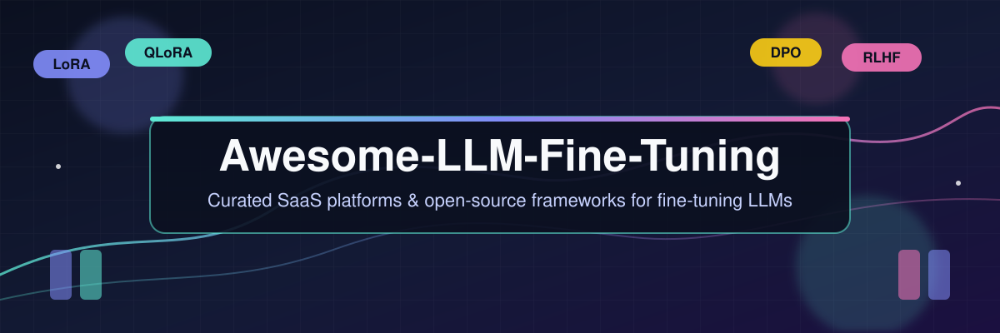

# Awesome-LLM-Fine-Tuning

  

<table>
  <tr>
    <td align="left">
      
    </td>
    <td align="right">
      
    </td>
  </tr>
</table>

> **LLM Fine-Tuning tools, compared:** the most complete curated list of **LLM fine-tuning platforms** (SaaS) and **open-source fine-tuning frameworks** — with side-by-side **pricing**, **free tier limits** and company scale. Covers **LoRA, QLoRA, RLHF, DPO, supervised fine-tuning (SFT), PEFT and full-parameter training** for Llama, Qwen, Mistral, Gemma, DeepSeek and Mixtral models.

## 🎯 Top LLM Fine-Tuning Ecosystem

**Curated List of SaaS Products & Open-Source GitHub Projects**  

*Focused on Parameter-Efficient Adaptation, Instruction Tuning & Model Customization*  

📅 **Last updated: March 2026**

This repository tracks notable **SaaS platforms** and **open-source projects** for **LLM Fine-Tuning**. These tools enable supervised fine-tuning (SFT), LoRA/QLoRA adaptation, reinforcement learning from human feedback (RLHF), direct preference optimization (DPO), and full-parameter training of open-source and proprietary language models.

💡 **Examples** include Predibase, Lamini, Scale AI, Together AI, Fireworks AI, OctoAI, MonsterAPI, RunPod, Baseten, and Modal (the category leaders).

🔓 **Open-source emphasis**: This section is heavily expanded with every major active project for self-hosting, consumer-hardware training, and transparent model customization — ideal for ML engineers, researchers, and developers building vendor-neutral fine-tuning pipelines.

🎉 Contributions welcome! Open a PR to add/update entries. Keep descriptions factual and link to official sites.

## 📚 Table of Contents

- [What Is LLM Fine-Tuning?](#what-is-llm-fine-tuning)

- [SaaS/Hosted Platforms](#saas-hosted-platforms)

- [Open-Source GitHub Projects](#open-source-github-projects)

- [How to Contribute](#how-to-contribute)

- [FAQ](#faq)

- [Disclaimer](#disclaimer)

## 🧠 What Is LLM Fine-Tuning?

**LLM fine-tuning** is the process of continuing the training of a large language model on a smaller, task-specific dataset so it learns a new skill, tone or domain at a fraction of the cost of pre-training. The most common techniques on this list are **parameter-efficient fine-tuning (PEFT)** methods such as **LoRA** and **QLoRA**, preference-alignment methods such as **RLHF** and **DPO**, classic **supervised fine-tuning (SFT)**, and **full-parameter (full-rank) training** for the largest models.

Use this page to (1) **compare hosted LLM fine-tuning platforms** by starting price and free tier, and (2) **pick an open-source fine-tuning library** ranked by GitHub stars — then pair either with the evaluation and data-prep guidance in the sections below.

## 💼 SaaS/Hosted Platforms

### 🌍 Sector Overview & Market Dynamics

🗺️ **Market size:** The global **LLM fine-tuning services** market was valued at **$1.38B in 2024** and is projected to reach **$13.65B by 2033** (28.7% CAGR) — covering custom model training, domain adaptation, data annotation and evaluation services (Growth Market Reports).

🏗️ **Structure:** The sector is **moderately fragmented, not winner-take-all**: hyperscalers (OpenAI, Google Cloud, Azure, AWS) compete with specialised post-training and GPU-inference platforms (Fireworks, Baseten, Modal, Together AI, RunPod, Scale), and no single provider holds a dominant share — buyers routinely multi-source across layers and model families.

| 🏢 Platform | 📈 Company Size (valuation / revenue) | 📝 Description | 💲 Pricing (starting tier) | 🎁 Free Tier Limits |
|---|---|---|---|---|
| **[Scale AI](https://scale.com/)** | **$29B valuation** (Meta's $14.3B for 49%, Jun 2025); **$870M revenue (2024)**, ~$2B estimated 2025 | Data labeling and model evaluation platform with fine-tuning services for enterprise AI teams. | Enterprise post-training sold **per project** via sales quote; Scale's own published example projects budgeted **~$890** and **~$230** of training compute per model. | No free-for-ever plan and no trial credits — projects are scoped and priced by contract with Scale's services team. |
| **[Fireworks AI](https://fireworks.ai/)** | **$17.5B valuation** ($1.505B Series D, Jul 2026); **>$1B annualized revenue run-rate** | Fast fine-tuning and serving of open models with multi-LoRA support and sub-second time-to-first-token (TTFT) for optimized inference. | LoRA SFT from **$0.50 per 1M training tokens** (models ≤ 16B params); inference from $0.10 / 1M tokens. | **$1 one-time starter credit** for new accounts — provisioning pauses once it's spent; no recurring free-for-ever quota. |
| **[Baseten](https://www.baseten.co/)** | **$13B valuation** ($1.5B Series F, Jun 2026); **~$600M annualized revenue** (Sacra estimate, Mar 2026) | Model serving and fine-tuning platform focused on production deployment of custom models. | Per-second GPU billing: **T4 $0.01052 / GPU-min (~$0.631 / hr)**, **L4 $0.01414 / GPU-min (~$0.848 / hr)**; Basic plan has a **$0/mo platform fee**. | **Trial credits issued to every new workspace on signup** (amount not published in the billing docs); no perpetual $0 plan. |
| **[Together AI](https://www.together.ai/)** | **$8.3B valuation** ($800M Series C, Jul 2026); **$1.15B annual bookings**, surpassed $100M annualized revenue (Feb 2025) | Open-model fine-tuning and inference platform with pay-per-token training; supports LoRA and full fine-tuning of Llama, Qwen, and Mixtral models. | LoRA SFT from **$0.34 per 1M training tokens**, with a **$4 minimum per fine-tuning job** (rates vary by model). | Free inference on open "Free" models at **$0 / 1M tokens**, but fine-tuning needs prepaid credits: **$15 minimum first credit purchase** ($5 on later top-ups), no trial days. |
| **[Modal](https://modal.com/)** | **$4.65B valuation** ($355M Series C, May 2026); **>$300M annualized revenue** | Serverless GPU platform with Python decorator-based infrastructure; cold starts around 1 second and second-level billing for fine-tuning workflows. | **T4 GPU $0.000164 / GPU-second (~$0.59 / GPU-hr)**, billed by the second with nothing charged while idle. | **Starter plan $0/mo with $30/month in recurring compute credits**, 3 seats, 100 containers, 10-way GPU concurrency, 1 TiB/month egress. |
| **[RunPod](https://www.runpod.io/)** | **$1B valuation** ($100M growth round, Jun 2026); **$120M ARR** (Jan 2026), ~$240M annualized reported | GPU cloud with fine-tuning templates and serverless endpoints; popular for cost-effective training of custom models. | Community Cloud from **$0.22 / GPU-hr (RTX 3090)**, **$0.34 / GPU-hr (RTX 4090)**, **$1.19 / GPU-hr (A100 80GB)** — billed per second. | No free-for-ever GPU tier; conditional credits: **$1,000 for accepted Startup Program Starter teams** and **$5–$500 referral credit** after a $10 top-up (most regions get $5). |
| **[OctoAI](https://octoai.cloud/)** | **~$900M valuation (2021)**; acquired by NVIDIA in 2024 for a reported **~$165–250M** | Cloud platform for deploying and fine-tuning generative AI models with optimized inference infrastructure. *(Commercial service wound down Oct 31, 2024; acquired by NVIDIA.)* | Last published rates: **Llama 3 8B $0.15 / 1M tokens**, Mixtral 8x7B **$0.30 in / $0.50 out per 1M tokens**, Mistral 7B $0.10 in / $0.25 out. | **$10 one-time signup credit** on self-serve accounts (historical); no free tier since the Oct 31, 2024 shutdown. |
| **[Lamini](https://www.lamini.ai/)** | **~$100–250M estimated valuation** (Dealroom, 2024); **$25M raised**, revenue est. <$1M/yr | Enterprise platform for fine-tuning and serving open-source LLMs with focus on data privacy and compliance. | Pay-as-you-go **On-Demand** GPU cluster: flat **per-token inference** rate plus a **per-tuning-step** charge (exact rate card quoted via [lamini.ai/pricing](https://www.lamini.ai/pricing)). | **$300 in one-time signup credits** for tuning, deployment and inference on the hosted cluster — no recurring free allowance. |
| **[Predibase](https://predibase.com/)** | **Acquired by Rubrik for $100–500M (Jun 2025)**, terms undisclosed; **$28M+ raised** prior | LoRA-centric fine-tuning platform with LoRAX multi-adapter serving; enables thousands of fine-tuned adapters on a single base model deployment. | Last published pay-as-you-go rates: serverless serving ≈ **$0.0002 per 1K tokens ($0.20 / 1M tokens)** for fine-tuned Llama-2-7B; fine-tuned models averaged **<$8 per job** in GPU cost. Now part of Rubrik — no current public rate card. | **14-day free trial**: unlimited fine-tuning & serving of Llama-2-13B at no cost (launched Oct 2023; eligibility unverified after the Rubrik acquisition). |
| **[MonsterAPI](https://monsterapi.ai/)** | **Undisclosed**; earliest disclosed funding **$1.1M pre-seed (2023)** | GPU cloud platform offering fine-tuning services and serverless inference for open-source LLMs. | Pay-as-you-go **prepaid credits** (credit packs in the dashboard); per-GPU-hour list price is not publicly published. | **5,000 free credits when signing up with GitHub** (2,500 via email), plus campaign codes such as **10,000 credits** (2024 `UFOsarereal` offer). |

## 🧩 Open-Source GitHub Projects

⭐ Every entry carries a live star badge (links to the repository stargazers page) and the list is sorted by GitHub stars, descending. Newly added options are marked *(New addition)*.

| 📦 Project | 📝 Description |
|---|---|
| **[Unsloth](https://github.com/unslothai/unsloth)**  | **Fastest open-source library for local LLM fine-tuning** — optimized for low VRAM (even laptops), plug-and-play with Hugging Face models. Enables 2-5x faster training with reduced memory usage. |
| **[LLaMA-Factory](https://github.com/hiyouga/LLaMA-Factory)**  | **All-in-one fine-tuning UI and CLI** — supports 100+ models (LLaMA, Qwen, DeepSeek, Gemma, GLM, Mistral) with continuous pre-training, SFT, reward modeling, PPO, DPO, KTO, ORPO. Day-0 support for cutting-edge releases. |
| **[DeepSpeed](https://github.com/microsoft/DeepSpeed)**  | Microsoft's deep learning optimization library for training massive models efficiently with memory and speed optimizations. Industry standard for scaling LLM training. |
| **[PEFT](https://github.com/huggingface/peft)**  | **Parameter-Efficient Fine-Tuning library** — implements LoRA, adapters, prefix tuning, and other efficient methods. The foundation for most modern fine-tuning workflows. |
| **[TRL (Transformer Reinforcement Learning)](https://github.com/huggingface/trl)**  | Hugging Face's library for RLHF, DPO, PPO, and reward modeling. Essential for post-training alignment of LLMs. |
| **[Alpaca-LoRA](https://github.com/tloen/alpaca-lora)**  | **The foundational LoRA fine-tuning implementation** for LLaMA — instruct-tune on consumer hardware in under 5 hours on a single RTX 4090. Uses Hugging Face PEFT and bitsandbytes for cheap, efficient adaptation. |
| **[Llama Cookbook](https://github.com/meta-llama/llama-cookbook)**  | **Meta's official Llama example recipes** — end-to-end fine-tuning, RAG and inference walkthroughs for Llama 3/3.1 models. *(New addition)* |
| **[ms-swift](https://github.com/modelscope/ms-swift)**  | ModelScope's Swift — **train/finetune 500+ LLM & multimodal models** (Qwen, Llama, DeepSeek, VL series) across LoRA/QLoRA/full-parameter settings. *(New addition)* |
| **[Lit-GPT](https://github.com/Lightning-AI/litgpt)**  | Lightning AI's hackable CSV-config toolkit for **pre-training, fine-tuning and evaluating 100+ open LLMs** with MLflow tracking. *(New addition)* |
| **[Axolotl](https://github.com/OpenAccess-AI-Collective/axolotl)**  | Flexible LLM fine-tuning configuration framework supporting LoRA, QLoRA, multi-GPU, and custom training pipelines. YAML-driven configs for reproducible experiments. |
| **[OpenRLHF](https://github.com/OpenRLHF/OpenRLHF)**  | **Scalable RLHF framework** — PPO, GRPO, DPO, RM and REINFORCE+ with Ray + vLLM + DeepSpeed orchestration for 70B+ models. *(New addition)* |
| **[Oumi](https://github.com/oumi-ai/oumi)**  | **Comprehensive open platform for training, evaluating, and deploying foundation models** — zero-boilerplate recipes for DeepSeek R1, Llama 3.1, Qwen, and vision models with remote cloud launch support. |
| **[torchtune](https://github.com/meta-pytorch/torchtune)**  | **Meta's native PyTorch library for LLM post-training** — clean recipes for SFT, DPO, RLHF and full fine-tuning of Llama 3.2/3.3. *(New addition)* |
| **[XTuner](https://github.com/InternLM/xtuner)**  | **Auto-generated fine-tuning configs** for 100+ LLMs and MLLMs — supports LoRA/QLoRA/full SFT, multi-GPU and deep-speed parallelism from a single YAML. *(New addition)* |
| **[Kiln](https://github.com/Kiln-AI/Kiln)**  | Easy tool for fine-tuning, synthetic data generation, and dataset collaboration. |
| **[H2O LLM Studio](https://github.com/h2oai/h2o-llmstudio)**  | No-code GUI framework for fine-tuning LLMs with enterprise features — designed for teams without deep ML expertise. |
| **[llm-foundry](https://github.com/mosaicml/llm-foundry)**  | MosaicML's **production LLM training stack** — configs for data prep, pre-training, instruction finetuning and evaluation. *(New addition)* |
| **[open-instruct](https://github.com/allenai/open-instruct)**  | AI2's **single-command pipeline for SFT, DPO/PPO/GRPO and reward modeling** across clusters, used to post-train OLMo models. *(New addition)* |
| **[OneTrainer](https://github.com/Nerogar/OneTrainer)**  | One-stop solution for Stable Diffusion training needs. |
| **[LLM-Finetuning (ashishpatel26)](https://github.com/ashishpatel26/LLM-Finetuning)**  | Comprehensive examples of fine-tuning with PEFT across multiple model families. |
| **[SimpleTuner](https://github.com/bghira/SimpleTuner)**  | General fine-tuning kit for diffusion models. |
| **[Maestro (Roboflow)](https://github.com/roboflow/maestro)**  | Streamlined fine-tuning for multimodal models (PaliGemma 2, Florence-2, Qwen2.5-VL). |
| **[xTuring](https://github.com/stochasticai/xTuring)**  | Build, customize, and control your own LLMs from data preprocessing to fine-tuning. |
| **[DB-GPT-Hub](https://github.com/eosphoros-ai/DB-GPT-Hub)**  | Text-to-SQL fine-tuning with models, datasets, and techniques. |
| **[ZO2](https://github.com/liangyuwang/zo2)**  | Zeroth-order offloading enabling **full-parameter fine-tuning of 175B LLMs with only 18GB GPU memory**. |
| **[DeepSpeed-Chat-Extension](https://github.com/wangclnlp/DeepSpeed-Chat-Extension)**  | Extensions for SFT and RLHF fine-tuning. |

🧰 **Frameworks for building custom systems**: Combine **Unsloth** or **Axolotl** for training, **PEFT** for parameter-efficient methods, **TRL** for alignment, **LLaMA-Factory** for UI-driven experimentation, and **vLLM** or **SGLang** for high-throughput serving. For distributed training, layer in **DeepSpeed** or **FSDP**. For LoRA serving at scale, **LoRAX** (Predibase) enables thousands of adapters on a single base model .

## 🤝 How to Contribute

1. Fork the repo.

2. Add/edit entries in `README.md` (follow existing format).

3. Include: name, link, 1–2 sentence description, and whether it's SaaS or open-source.

4. Submit PR with a short explanation.

⭐ Star the repo if you find it useful!

## ❓ FAQ

**What is the best LLM fine-tuning platform?**

It depends on budget and scale. For cheap per-token training try **Together AI** ($0.34 / 1M training tokens) or **Fireworks AI** ($0.50 / 1M); for serverless GPU-hours try **Modal** (~$0.59 / GPU-hr with $30/month free credits) or **RunPod** ($0.22 / GPU-hr); for enterprise post-training and data pipelines, **Scale AI** and **Predibase**.

**Which open-source library should I use to fine-tune an LLM?**

**Unsloth** for single-GPU speed and low VRAM, **LLaMA-Factory** for a no-code UI over 100+ models, **Axolotl** for YAML-driven reproducible runs, **TRL + PEFT** for RLHF/DPO pipelines, and **DeepSpeed** or **FSDP** for multi-node training.

**How much does LLM fine-tuning cost?**

Hosted LoRA SFT starts around **$0.34–$0.50 per 1M training tokens**, while renting GPUs starts at **$0.22–$0.63 per GPU-hour** (RunPod, Modal, Baseten). A small LoRA run on a 7B–8B model typically costs single-digit dollars; see the pricing column above for exact starting rates and free tiers.

**Is fine-tuning always necessary?**

No — evaluate prompting, retrieval-augmented generation (RAG) and in-context examples first; roughly 80% of perceived fine-tuning needs are better addressed upstream.

## ⚠️ Disclaimer

- 📌 This is a **community-curated** list — not exhaustive and not an endorsement.

- Fine-tuning requires careful data preparation, evaluation harnesses, and validation splits to avoid overfitting and catastrophic forgetting.

- Self-hosted training requires GPU infrastructure, proper experiment tracking (W&B, TensorBoard, MLflow), and checkpoint management.

- Always evaluate whether prompting or RAG can solve your problem before committing to fine-tuning — 80% of perceived fine-tuning needs are better addressed upstream .

## 📈 Star History

---

🔍 **Popular searches:** LLM fine-tuning platforms · LoRA fine-tuning tools · QLoRA training · RLHF and DPO libraries · open-source LLM training · best fine-tuning framework 2026 · LLM fine-tuning pricing comparison · PEFT library.

🙌 **Made for ML engineers, AI researchers, data scientists, and open-source enthusiasts.**  
Let's make LLM fine-tuning more accessible, efficient, and vendor-neutral.
